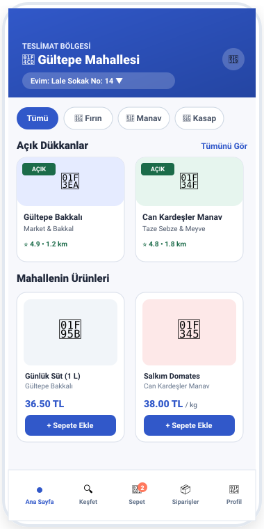
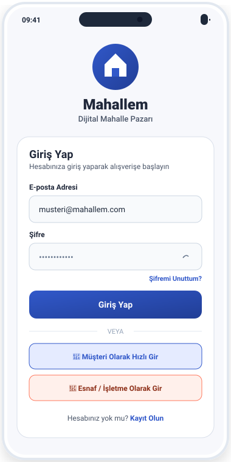
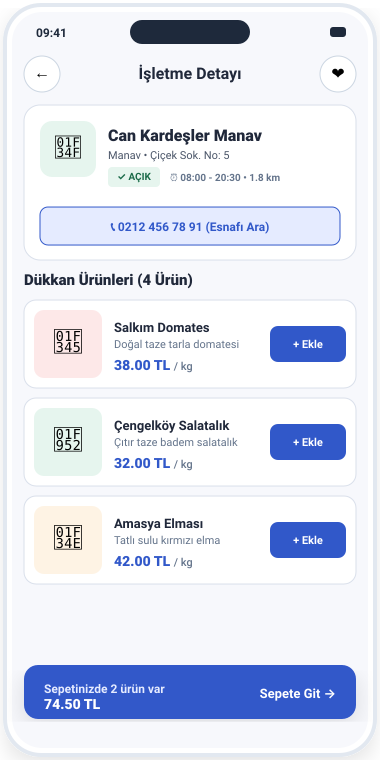
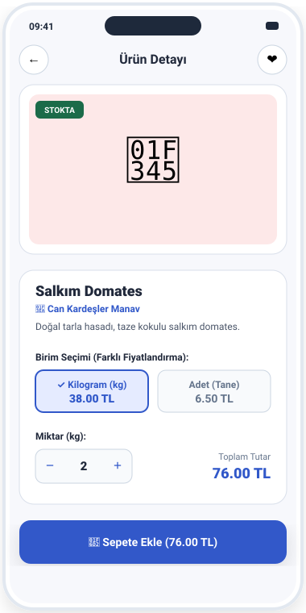
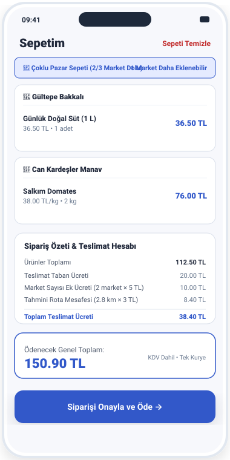
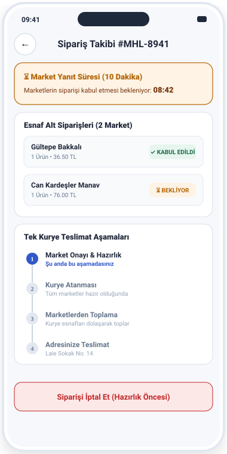
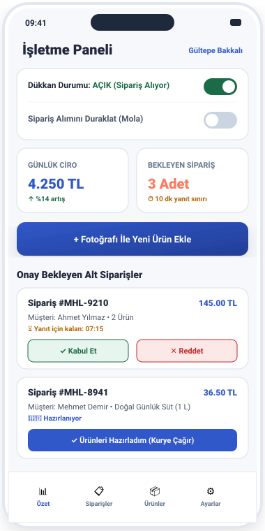
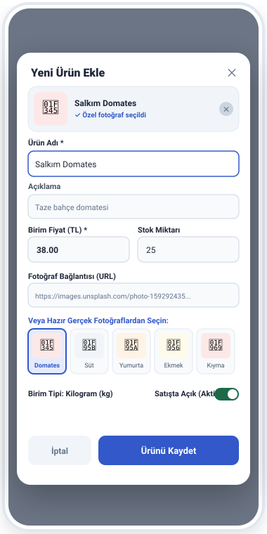
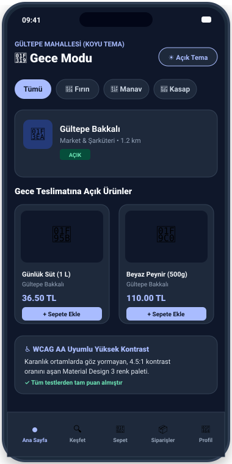

# 🛒 Mahallem — Dijital Mahalle Pazarı

<p align="center">
  
</p>

<p align="center">
  <strong>Geleneksel mahalle esnafı ile mahalle sakinlerini tek bir sepette ve tek bir kuryede buluşturan yeni nesil yerel ticaret platformu.</strong>
</p>

<p align="center">
  
  
  
  
  
  
  
  
</p>

---

## 📖 İçindekiler
- [Proje Hakkında](#-proje-hakkında)
- [Öne Çıkan Özellikler](#-öne-çıkan-özellikler)
- [Uygulama İçi Ekran Görüntüleri](#-uygulama-içi-ekran-görüntüleri)
  - [1. Giriş ve Müşteri Keşif Akışı](#1-giriş-ve-müşteri-keşif-akışı)
  - [2. Alışveriş, Çoklu Sepet ve Sipariş Takibi](#2-alışveriş-çoklu-sepet-ve-sipariş-takibi)
  - [3. Esnaf Yönetim Paneli ve Koyu Tema](#3-esnaf-yönetim-paneli-ve-koyu-tema)
- [Mimari Yapı (Clean Architecture & Feature-First)](#-mimari-yapı)
- [Teknoloji Yığını ve Tercih Nedenleri](#-teknoloji-yığını-ve-tercih-nedenleri)
- [Kesinleşen İş Kuralları ve Algoritmalar](#-kesinleşen-iş-kuralları-ve-algoritmalar)
- [Klasör ve Modül Düzeni](#-klasör-ve-modül-düzeni)
- [Kurulum ve Çalıştırma](#-kurulum-ve-çalıştırma)
- [Test ve Kalite Güvencesi](#-test-ve-kalite-güvencesi)

---

## 🌟 Proje Hakkında

**Mahallem**, süpermarket zincirleri ve hızlı teslimat devleri karşısında zorluk yaşayan yerel mahalle esnafını (bakkal, manav, kasap, fırın, şarküteri vb.) korumak ve mahalle sakinlerine güvenilir, taze ve samimi bir dijital alışveriş deneyimi sunmak amacıyla tasarlanmıştır.

### 💡 Temel Farkımız:
- **Tek Sepette Çoklu Pazar**: Müşteri bakkaldan süt, manavdan domates, kasaptan kıymayı tek bir sepete ekler.
- **Tek Kurye Dağıtımı**: Her dükkan için ayrı ayrı kurye ücreti ödenmez; tek bir kurye belirlenen rota üzerinde esnafları dolaşarak siparişleri toplar ve müşteriye tek teslimatta ulaştırır.
- **Dinamik ve Şeffaf Teslimat Formülü**: Müşteri ödediği kurye ücretinin her kuruşunun hesabını net olarak görür.
- **Alt Sipariş (Sub-Order) Yönetimi**: Sipariş onaylandığında her esnaf sadece kendi dükkanına ait ürünleri görür ve bağımsız olarak kabul/ret/hazırlık işlemlerini yönetir.

---

## ✨ Öne Çıkan Özellikler

- 🛍️ **Çoklu Market Sepeti (En Fazla 3 Market Sınırı)**: Operasyonel verimlilik ve kurye toplama süresini optimize etmek için sipariş başına en fazla 3 dükkan kuralı uygulanır; 4. dükkan denendiğinde kullanıcı bilgilendirilir.
- 🧮 **Formüllü Teslimat Ücreti Motoru**: `20 TL (Taban) + (Market Sayısı × 5 TL) + (Rota Km × 3 TL)` formülüyle çalışan şeffaf teslimat fiyatlandırması.
- ⏱️ **Zaman Damgalı Süreç Yönetimi & Canlı Sayaçlar**:
  - **10 Dakika**: Esnafın siparişi kabul/ret etme süresi.
  - **5 Dakika**: Bir marketin reddetmesi durumunda müşterinin kalan marketlerle devam etme veya tüm siparişi iptal etme karar süresi.
- ⚖️ **Kg ve Adet Bazlı Dinamik Birim Fiyatlandırma**: Manav ve kasap ürünlerinde kilogram veya adet/tane seçimi yapılabilir; birimler kendi özel fiyatlarıyla sepete eklenir.
- 📸 **Ürün Fotoğrafı & Hazır Unsplash Galerisi**: Esnaf ürün eklerken canlı önizleme eşliğinde web fotoğraf URL'si girebilir veya tek tıkla yüksek çözünürlüklü hazır fotoğraflardan (Süt, Ekmek, Domates, Kıyma vb.) seçim yapabilir.
- 🏪 **Esnaf Kontrol Paneli**: Günlük ciro, sipariş sayıları, dükkanı açma/kapatma (otomatik açılma tercihiyle) ve sipariş kabulünü geçici duraklatma (yoğunluk molası).
- 🛵 **Tek Kurye Simülasyonu**: Kurye atandı $\to$ Marketlerden toplanıyor $\to$ Yolda $\to$ Teslim edildi aşamaları deterministik zaman çizelgesiyle canlı takip edilir.
- 🌓 **Material 3 Açık & Koyu Tema**: WCAG AA erişilebilirlik standardına ($> 4.5:1$ kontrast oranı) uygun dinamik tema desteği.
- 🔍 **Akıllı Türkçe Karakter Duyarsız Arama**: `SearchFilterHelper` ile Türkçe karakterler (`ç, ğ, ı, ö, ş, ü`) normalize edilir ve semantik kategori eşleştirmesi yapılır.
- 📦 **Stok Güvencesi & Tek Seferlik İade**: Sipariş verildiğinde stok rezerve edilir; sipariş iptalinde veya esnaf reddinde `isStockReleased` korumasıyla stoklar tam 1 kez iade edilir.

---

## 📱 Uygulama İçi Ekran Görüntüleri

### 1. Giriş ve Müşteri Keşif Akışı

| Giriş & Rol Seçim Ekranı | Müşteri Ana Sayfası | Dükkan Detay Ekranı |
| :---: | :---: | :---: |
|  |  |  |
| *Müşteri / Esnaf hızlı giriş butonları ve şifre sıfırlama* | *Dinamik adres seçici, kategori chipleri, açık esnaflar ve vitrin* | *Can Kardeşler Manavı, dükkan çalışma saatleri, "Ara" aksiyonu ve ürünler* |

---

### 2. Alışveriş, Çoklu Sepet ve Sipariş Takibi

| Ürün Detayı (Kg/Adet Fiyatı) | Çoklu Pazar Sepeti (2/3 Market) | Canlı Sipariş & Kurye Takibi |
| :---: | :---: | :---: |
|  |  |  |
| *Kg veya adet birim seçimi, miktar sayacı ve sepete ekleme* | *Esnaf bazlı gruplama, teslimat ücreti formül dökümü ve genel toplam* | *10 dk market geri sayımı, alt sipariş durumları ve kurye zaman çizelgesi* |

---

### 3. Esnaf Yönetim Paneli ve Koyu Tema

| Esnaf Yönetim Paneli | Yeni Ürün & Fotoğraf Galerisi | Koyu Tema (Gece Modu) |
| :---: | :---: | :---: |
|  |  |  |
| *Günlük ciro, bekleyen siparişler, dükkan açık/mola switchleri* | *Canlı görsel önizleme, URL girişi ve hazır 1-tık Unsplash galerisi* | *WCAG AA uyumlu, göz yormayan yüksek kontrastlı gece teması* |

---

## 🏗️ Mimari Yapı

Proje, kurumsal ölçekte test edilebilirliği ve sürdürülebilirliği garanti altına alan **Clean Architecture (Temiz Mimari)** ve **Feature-First (Özellik Odaklı)** prensiplerine göre yapılandırılmıştır.

```text
┌─────────────────────────────────────────────────────────────┐
│                     Presentation Layer                      │
│      Screens, Widgets, BLoC (State Management), Dialogs      │
└──────────────────────────────┬──────────────────────────────┘
                               │ (Dependency Inversion)
┌──────────────────────────────▼──────────────────────────────┐
│                        Domain Layer                         │
│           Entities (Immutable) & Repository Interfaces      │
└──────────────────────────────▲──────────────────────────────┘
                               │ (implements)
┌──────────────────────────────┴──────────────────────────────┐
│                         Data Layer                          │
│     Repository Implementations (Cloud Firestore / In-Memory)│
└─────────────────────────────────────────────────────────────┘
```

- **Domain Katmanı**: İş kurallarını barındırır, saf Dart kodudur ve hiçbir UI veya harici kütüphaneye bağımlı değildir.
- **Data Katmanı**: `RepositoryImpl` sınıfları aracılığıyla Firebase Firestore ve yerel bellek içi veri kaynaklarını yönetir.
- **Presentation Katmanı**: Flutter widget'ları ve BLoC durum yöneticileri ile reaktif kullanıcı arayüzünü oluşturur.

---

## 🛠️ Teknoloji Yığını ve Tercih Nedenleri

| Teknoloji | Versiyon | Tercih Nedeni |
| :--- | :--- | :--- |
| **Flutter & Dart** | `Flutter 3.47+` / `Dart 3.13+` | Tek kod tabanından hem Android hem iOS için 60/120 FPS akıcı yerel performans. |
| **flutter_bloc** | `^9.1.1` | Tek yönlü veri akışı (`Event` $\to$ `BLoC` $\to$ `State`) ile öngörülebilir durum yönetimi. |
| **equatable** | `^3.0.0` | Nesnelerde değer eşitliği sağlayarak gereksiz widget re-render'larını önleme. |
| **Firebase Auth & Firestore** | `^7.0+` / `^7.1+` | Spark ücretsiz planında kalma garantisi, sıfır sunucu bakım maliyeti ve anlık NoSQL veri senkronizasyonu. |
| **Material Design 3 & WCAG AA** | M3 Spec | Modern dinamik renk tokenları (`AppColors`), en az $48\text{ px}$ dokunma hedefleri ve yüksek kontrast. |
| **intl** | `^0.20.3` | Türkçe para birimi (`TL`), tarih ve sayı formatlama standartları. |

---

## 📐 Kesinleşen İş Kuralları ve Algoritmalar

### 1. Çoklu Market ve Sepet Sınırı
- Bir siparişte en fazla **3 farklı marketten** ürün bulunabilir.
- 4. bir marketten ürün eklenmeye çalışıldığında sepet işlemi engellenir ve kullanıcıya açıklayıcı uyarı gösterilir.

### 2. Şeffaf Teslimat Ücreti Formülü
$$\text{Toplam Teslimat Ücreti} = 20.0\text{ TL (Taban)} + (\text{Market Sayısı} \times 5.0\text{ TL}) + (\text{Rota Km} \times 3.0\text{ TL})$$
- *1 Market İçin*: $20 + (1 \times 5) + (1.5 \times 3) = \mathbf{29.50\text{ TL}}$
- *2 Market İçin*: $20 + (2 \times 5) + (2.8 \times 3) = \mathbf{38.40\text{ TL}}$
- *3 Market İçin*: $20 + (3 \times 5) + (4.2 \times 3) = \mathbf{47.60\text{ TL}}$

### 3. Zaman Damgalı Sipariş Döngüsü
- **Market Yanıt Süresi (10 Dakika)**: Dükkanlar siparişi onaylamazsa zaman aşımına uğrar.
- **Müşteri Karar Süresi (5 Dakika)**: Marketlerden biri reddettiğinde, müşteri kalanlarla devam etme veya iptal etme kararını 5 dakika içinde vermelidir. Karar verilmezse tüm sipariş otomatik iptal edilir.
- **İptal Kısıtı**: Müşteri hazırlık başlamadan önce iptal edebilir; hazırlık başladıktan sonra doğrudan iptal engellenir.
- **Stok Güvencesi**: Sipariş iptal edildiğinde stoklar yalnızca **1 kez** iade edilir.

---

## 📁 Klasör ve Modül Düzeni

```text
lib/
├── main.dart                                    # Uygulama başlangıcı, Firebase & BLoC enjeksiyonu
├── core/                                        # Çekirdek modül (ortak servisler, tema, yardımcılar)
│   ├── constants/                               # Sabitler (AppConstants) ve örnek veriler (SampleData)
│   ├── services/                                # Reaktif AddressService, FavoritesService, ThemeService
│   ├── theme/                                   # AppColors (WCAG AA), AppTheme, Light & Dark Theme
│   ├── utils/                                   # DeliveryFeeCalculator, SearchFilterHelper, CurrencyFormatter
│   └── widgets/                                 # AppButton, AppTextField, ProductVisualBadge, EmptyStateView
└── features/                                    # Feature-First modüller
    ├── auth/                                    # Giriş, kayıt, şifre sıfırlama, kullanıcı varlıkları
    ├── cart/                                    # Sepet varlığı, BLoC, 3 market kuralı denetimi
    ├── customer/                                # Müşteri ana sayfası, keşfet, dükkan ve ürün detayları
    ├── navigation/                              # Müşteri ve Esnaf alt gezinme kabukları (Shell)
    ├── order/                                   # Sipariş oluşturma, alt siparişler, sayaçlar ve kurye
    ├── product/                                 # Ürün kataloğu, kg/adet birim fiyatlandırması
    └── store/                                   # Esnaf paneli, ciro, mola switchleri, ürün ekleme dialogu
```

---

## 🚀 Kurulum ve Çalıştırma

Projeyi yerel geliştirme ortamınızda ayağa kaldırmak için aşağıdaki adımları izleyin:

### Ön Gereksinimler:
- [Flutter SDK](https://docs.flutter.dev/get-started/install) (`>= 3.13.7`)
- Android Studio / VS Code
- Android Emülatör veya Fiziksel Cihaz

### Adımlar:
```bash
# 1. Projeyi klonlayın
git clone https://github.com/kullaniciadi/mahallem.git
cd mahallem

# 2. Bağımlılıkları yükleyin
flutter pub get

# 3. Statik kod analizini çalıştırın (0 hata / 0 uyarı garantisi)
flutter analyze

# 4. Tüm otomatik birim ve arayüz testlerini çalıştırın
flutter test

# 5. Uygulamayı başlatın
flutter run
```

> **Not**: Firebase yapılandırması mevcut olmadığında uygulama otomatik olarak `In-Memory Fallback` moduna geçer ve tüm özellikleri zengin demo verileriyle kesintisiz olarak çalışır.

---

## 🧪 Test ve Kalite Güvencesi

Projedeki tüm kritik iş mantığı, formüller, kısıtlamalar ve widget davranışları **22 adet otomatik test** ile korunmaktadır:

```bash
$ flutter test
00:04 +22: All tests passed!
```

### Doğrulanan Temel Test Senaryoları:
1. `1 market teslimat ücreti formülü (29.50 TL)`
2. `2 market teslimat ücreti formülü (38.40 TL)`
3. `3 market teslimat ücreti formülü (47.60 TL)`
4. `4. marketten ürün ekleme denendiğinde sepetin engellenmesi ve uyarı fırlatılması`
5. `Sipariş verildiğinde stok rezervasyonu ve iptalde stokların tam 1 kez iade edilmesi`
6. `Hazırlık başladıktan sonra müşteri iptalinin kilitlenmesi`
7. `Deterministik kurye aşamaları zaman hesabı`
8. `Sepet simgesi üzerindeki rozetin adetlerin toplamı değil, ürün çeşidi sayısı olması`
9. `Kg ve adet fiyatlarının birbirinden bağımsız ve doğru hesaplanması`
10. `Canlı açık ve koyu tema geçişi`
11. `Varsayılan adres değiştiğinde tüm dinleyicilerin anında güncellenmesi`
12. `İptal edilen siparişlerin aktif sipariş sekmesinden çıkması`
13. `İşletmeye yeni ürün ekleme, fotoğraf kaydetme ve güncelleme işlemleri`
14. `Türkçe karakter duyarsız arama ve semantik kategori eşleştirme`
15. `Material 3 erişilebilirlik ve minimum 48px dokunma hedefleri testi`

---

## 📄 Lisans

Bu proje eğitim ve geliştirme amacıyla açık kaynak olarak sunulmuştur. Tüm hakları saklıdır.

<p align="center">
  Geliştirici: <strong>Mahallem Proje Ekibi</strong> • 2026
</p>
