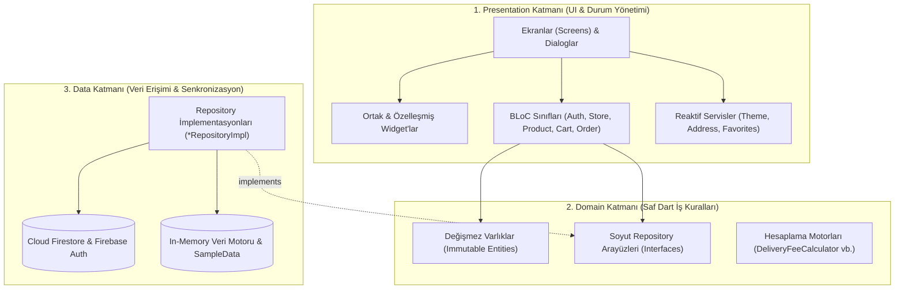
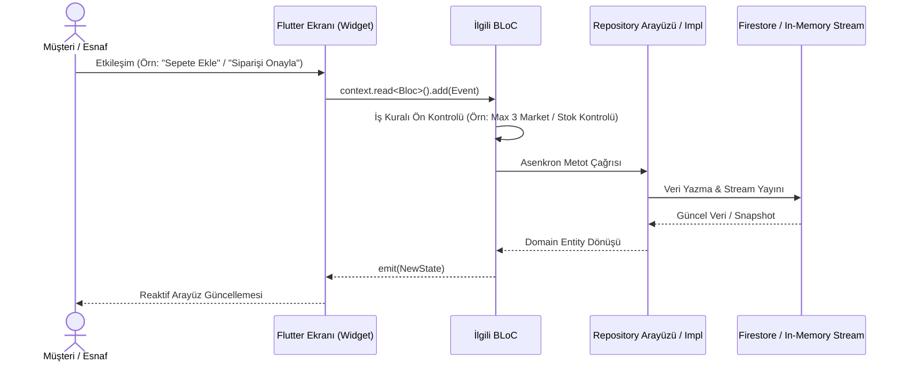
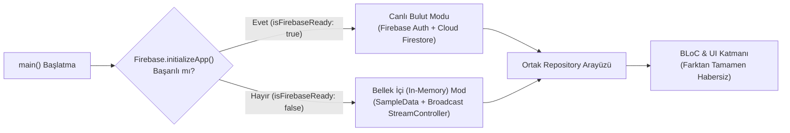
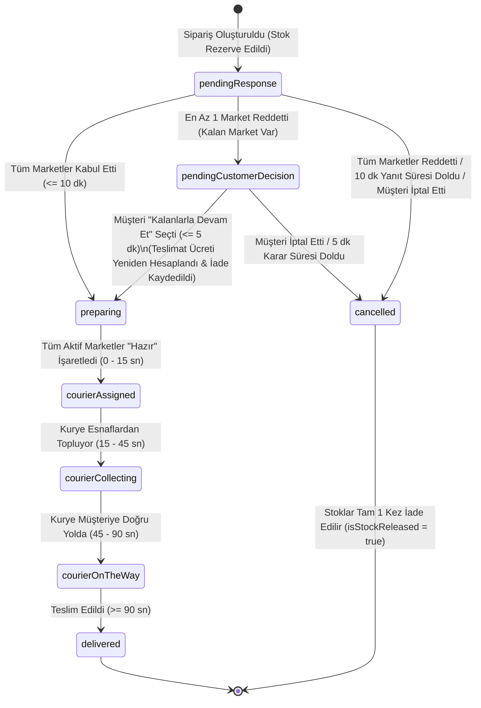

# Mahallem — Detaylı Mimari Raporu ve Teknoloji Dokümantasyonu

Bu doküman, **Mahallem - Dijital Mahalle Pazarı** uygulamasının yazılım mimarisini, katmanlar arası iletişim protokollerini, kullanılan teknoloji yığınını, veri modellerini, durum makinesini (State Machine) ve mühendislik tasarım kararlarını uçtan uca detaylandıran teknik mimari rapordur.

---

## İçindekiler
1. [Yönetici Özeti ve Mimari Vizyon](#1-yönetici-özeti-ve-mimari-vizyon)
2. [Kullanılan Teknolojiler ve Tercih Nedenleri](#2-kullanılan-teknolojiler-ve-tercih-nedenleri)
3. [Mimari Yaklaşım: Clean Architecture & Feature-First](#3-mimari-yaklaşım-clean-architecture--feature-first)
4. [Durum Yönetimi (State Management) ve Veri Akışı](#4-durum-yönetimi-state-management-ve-veri-akışı)
5. [Çift Modlu Veri Katmanı (Dual-Mode Repository Pattern)](#5-çift-modlu-veri-katmanı-dual-mode-repository-pattern)
6. [Sipariş Durum Makinesi (Order State Machine) ve İş Kuralları](#6-sipariş-durum-makinesi-order-state-machine-ve-iş-kuralları)
7. [Veritabanı Modeli ve Güvenlik Mimarisi (`firestore.rules`)](#7-veritabanı-modeli-ve-güvenlik-mimarisi-firestorerules)
8. [Modül ve Katman Bazlı Sorumluluk Matrisi](#8-modül-ve-katman-bazlı-sorumluluk-matrisi)
9. [Tasarım Sistemi, Erişilebilirlik ve Görsel Varlık Mimarisi](#9-tasarım-sistemi-erişilebilirlik-ve-görsel-varlık-mimarisi)
10. [Test Mimarisi ve Kalite Güvencesi](#10-test-mimarisi-ve-kalite-güvencesi)

---

## 1. Yönetici Özeti ve Mimari Vizyon

**Mahallem**, mahalle sakinlerinin aynı sepette **en fazla 3 farklı yerel esnaftan** (bakkal, manav, kasap, fırın vb.) alışveriş yapabildiği, siparişin arka planda her esnaf için bağımsız **alt siparişlere (Sub-Order)** bölündüğü ve tüm onaylanan paketlerin **tek bir kurye rotasıyla** müşteriye ulaştırıldığı çok taraflı (Müşteri + Esnaf) bir yerel pazar yeri uygulamasıdır.

### Mimari Hedefler:
- **Sıfır Katman Sızıntısı (Zero Layer Leakage)**: İş kurallarının (`Domain`) kullanıcı arayüzünden (`Presentation`) ve veritabanı altyapısından (`Data`) tamamen izole edilmesi.
- **Kesintisiz Çalışabilirlik (Fault-Tolerant Runtime)**: Bulut bağlantısı veya Firebase yapılandırma dosyası bulunmadığında dahi uygulamanın çökmeden bellek içi (`In-Memory`) veri motoruyla %100 fonksiyonellikle çalışması.
- **Deterministik İş Kuralları**: Teslimat ücreti hesaplaması, stok rezervasyonu/iadesi, 10 dakikalık esnaf yanıt süresi, 5 dakikalık müşteri karar süresi ve kurye aşamalarının zaman damgaları (`Timestamp`) üzerinden deterministik olarak yürütülmesi.
- **Yüksek Performans ve Ölçeklenebilirlik**: `Equatable` destekli değişmez (`immutable`) veri modelleri ve `BLoC` akışlarıyla gereksiz widget yeniden çizimlerinin (re-render) önlenmesi.

---

## 2. Kullanılan Teknolojiler ve Tercih Nedenleri

Projede kullanılan tüm kütüphaneler, sürümleri ve mimari tercih gerekçeleri aşağıda detaylandırılmıştır:

| Teknoloji / Paket | Sürüm | Katman | Kullanım Amacı ve Mühendislik Tercih Nedeni |
| :--- | :--- | :--- | :--- |
| **Flutter SDK** | `3.47+` | UI / Çekirdek | Tek bir kod tabanından iOS (Impeller/Metal), Android, Web ve masaüstü platformlarına 60/120 FPS yerel (native) ARM makine kodu derlemesi sağlar. |
| **Dart SDK** | `^3.13.7` | Tüm Katmanlar | Güçlü tip güvenliği (Sound Null Safety), `pattern matching` (`switch` ifadeleri), `record` tipleri ve asenkron `Stream`/`Future` desteği sunar. |
| **`flutter_bloc`** | `^9.1.1` | Presentation | **Business Logic Component** deseni ile olay güdümlü (`Event -> BLoC -> State`) tek yönlü veri akışı sağlar. Karmaşık çoklu market sepeti ve sipariş durum geçişlerini izole ve test edilebilir kılar. |
| **`equatable`** | `^3.0.0` | Domain & Presentation | Dart'ta referans eşitliği yerine **değer eşitliği (value equality)** sağlar. `Entity`, `Event` ve `State` nesnelerinde yalnızca içerik değiştiğinde UI güncellenmesini tetikleyerek performansı optimize eder. |
| **`firebase_core`** | `^5.1.0` | Data / Altyapı | Firebase ekosisteminin çoklu platform başlatma (`Firebase.initializeApp()`) ve yaşam döngüsü yönetimini üstlenir. |
| **`firebase_auth`** | `^7.0.1` | Data | Müşteri ve esnaf hesapları için e-posta/şifre tabanlı kimlik doğrulama, oturum durumu akışı (`authStateChanges`) ve şifre sıfırlama süreçlerini yönetir. |
| **`cloud_firestore`** | `^7.1.0` | Data | Gerçek zamanlı NoSQL belge veritabanı. Müşteri sipariş verdiğinde esnaf ekranına anlık (`snapshots()`) düşmesini ve alt sipariş onaylarının canlı senkronizasyonunu sağlar. |
| **`intl`** | `^0.20.3` | Core / Utils | Para birimi (`TL`), ondalık basamak ve tarih/saat gösterimlerinin yerel standartlara uygun biçimlendirilmesini sağlar. |
| **`cupertino_icons`** | `^1.0.8` | Presentation | iOS platform standartlarına uygun ikon setini sağlar. |
| **`flutter_test`** | SDK | Test | İş kuralları, BLoC durum geçişleri ve erişilebilirlik/widget duman testlerinin (`22/22` test) otomasyonunu sağlar. |
| **`flutter_lints`** | `^6.0.0` | Kalite Güvence | Dart/Flutter resmi statik analiz kurallarını zorunlu kılarak kod kalitesini ve tip güvenliğini (`0 error, 0 warning`) korur. |

---

## 3. Mimari Yaklaşım: Clean Architecture & Feature-First

Uygulama, **Clean Architecture (Temiz Mimari)** prensiplerini **Feature-First (Özellik Odaklı)** modüler paketleme yapısıyla birleştirir.



### 3.1. Katmanların Sorumlulukları ve Bağımlılık Kuralı

1. **Domain Katmanı (`domain/`)**:
   - Mimarinin merkezidir. Hiçbir Flutter UI bileşenine veya üçüncü parti veritabanı paketine (`cloud_firestore` vb.) doğrudan iş mantığı bağımlılığı yoktur.
   - **`Entities`**: İş kurallarını üzerinde taşıyan değişmez (`final`) sınıflardır (`OrderEntity`, `SubOrderEntity`, `CartEntity`, `ProductEntity`, `StoreEntity`, `UserEntity`, `AddressEntity`).
   - **`Repositories (Abstract)`**: Data katmanının uymak zorunda olduğu sözleşmeleri (`interface`) tanımlar. **Dependency Inversion Principle (DIP)** gereği BLoC sınıfları somut sınıflara değil, bu soyut arayüzlere bağımlıdır.

2. **Data Katmanı (`data/`)**:
   - Domain katmanındaki soyut repository arayüzlerini somut olarak uygular (`AuthRepositoryImpl`, `StoreRepositoryImpl`, `ProductRepositoryImpl`, `OrderRepositoryImpl`, `AddressRepositoryImpl`).
   - JSON/Map serileştirme (`_toFirestore`, `_fromFirestore`), Firestore `Transaction` yönetimi ve çevrimdışı bellek içi (`_memoryProducts`, `_memoryStores`, `_memoryOrders`) akış denetleyicilerini (`StreamController.broadcast()`) barındırır.

3. **Presentation Katmanı (`presentation/`)**:
   - Kullanıcı etkileşimini yakalar, `BLoC` katmanına `Event` olarak iletir ve üretilen `State` nesnelerine göre arayüzü yeniden çizer.
   - Müşteri (`CustomerNavigationShell`) ve Esnaf (`BusinessNavigationShell`) olmak üzere iki ayrı rol tabanlı gezinme kabuğuna (Navigation Shell) sahiptir.

---

## 4. Durum Yönetimi (State Management) ve Veri Akışı

Uygulamada durum yönetimi iki tamamlayıcı mekanizma ile yürütülür:

### 4.1. BLoC (Business Logic Component) Mimarisi
Uygulamanın kökünde (`MahallemApp`), `MultiRepositoryProvider` ve `MultiBlocProvider` kullanılarak bağımlılık enjeksiyonu (Dependency Injection) gerçekleştirilir:

- **`AuthBloc`**: Oturum açma, müşteri/esnaf kaydı, şifre sıfırlama, rol geçişi ve hesap silme akışlarını yönetir.
- **`StoreBloc`**: Mahalle esnaflarının listelenmesi, mağaza açık/kapalı durumu, yoğunluk molası (`isPaused`) ve çalışma saatleri güncellemelerini yönetir.
- **`ProductBloc`**: Ürün kataloğunun tamamını veya mağaza bazlı filtrelenmiş ürünleri yükler; yeni ürün ekleme, birim fiyat (`kg`/`adet`) güncelleme ve ürün silme işlemlerini yürütür.
- **`CartBloc`**: Çoklu market sepetini yönetir. Maksimum 3 market sınırını denetler, ürün birimlerine (`kg`, `adet`, `paket`, `porsiyon`) göre ara toplamları ve dinamik teslimat ücretini anlık hesaplar.
- **`OrderBloc`**: Siparişin oluşturulması, alt siparişlerin (`SubOrder`) kabul/ret/hazır durum geçişleri, ret sonrası müşterinin kalan marketlerle devam etmesi ve sipariş iptali süreçlerini yönetir.



### 4.2. Hafif Siklet Reaktif Servisler (`ValueNotifier`)
Büyük BLoC merasimine ihtiyaç duymayan, uygulama genelinde anlık senkronize olması gereken yerel tercihler için `ValueNotifier` tabanlı servisler kullanılmıştır:
- **`ThemeService`**: Açık (`ThemeMode.light`) ve Koyu (`ThemeMode.dark`) tema geçişlerini `ValueListenableBuilder` ile milisaniyeler içinde tüm uygulamaya yansıtır.
- **`AddressService`**: Aktif teslimat adresini (`defaultAddress`) ve adres listesini reaktif olarak yayınlar; adres değiştiğinde Ana Sayfa başlığı ve Sepet ekranı anında güncellenir.
- **`FavoritesService`**: Favori esnaf (`favoriteStoreIds`) ve favori ürün (`favoriteProductIds`) kümelerini (`Set<String>`) reaktif olarak yönetir.

---

## 5. Çift Modlu Veri Katmanı (Dual-Mode Repository Pattern)

Mimarin en güçlü mühendislik özelliklerinden biri **Graceful Fallback (Zarif Geri Düşüş)** sağlayan çift modlu veri katmanıdır.



- [main.dart](file:///Users/d1-6/Desktop/mahallem/lib/main.dart#L35-L78) içerisinde `Firebase.initializeApp()` güvenli bir `try-catch` bloğu içinde çağrılır.
- Ortamda `google-services.json` veya `GoogleService-Info.plist` bulunmasa dahi uygulama hata vermez; `isFirebaseReady = false` olarak işaretlenir ve tüm `*RepositoryImpl` sınıfları dahili `StreamController.broadcast()` ve `SampleData` koleksiyonları üzerinden gerçek zamanlı veritabanı davranışını birebir simüle eder.
- Bu sayede hem geliştirme/simülatör ortamında hem de CI/CD test süreçlerinde dış ağ veya bulut bağımlılığı olmadan tüm uçtan uca senaryolar (Müşteri sipariş verir ->Profil ekranından Esnaf paneline geçilir -> Esnaf siparişi görür ve onaylar -> Kurye başlar) kesintisiz çalışır.

---

## 6. Sipariş Durum Makinesi (Order State Machine) ve İş Kuralları

Mahallem'in çekirdek iş mantığı, çoklu market siparişlerinin yaşam döngüsünü yöneten deterministik durum makinesidir ([order_entity.dart](file:///Users/d1-6/Desktop/mahallem/lib/features/order/domain/entities/order_entity.dart) ve [order_repository_impl.dart](file:///Users/d1-6/Desktop/mahallem/lib/features/order/data/repositories/order_repository_impl.dart)).



### Kritik Algoritmalar ve Kurallar:

1. **Maksimum 3 Market Kısıtı**:
   - `CartEntity.canAddProductFromStore(storeId)` metodu sepetteki benzersiz `storeId` sayısını kontrol eder. Sayı `AppConstants.maxMarketsPerOrder` (`3`) değerine ulaşmışsa 4. farklı marketten ürün eklenmesini reddeder.
2. **Dinamik Teslimat Ücreti Formülü** ([delivery_fee_calculator.dart](file:///Users/d1-6/Desktop/mahallem/lib/core/utils/delivery_fee_calculator.dart)):
   $$\text{Teslimat Ücreti} = 20.0\text{ TL} + (\text{Market Sayısı} \times 5.0\text{ TL}) + (\text{Rota Mesafesi (km)} \times 3.0\text{ TL})$$
   - **1 Market** ($1.5\text{ km}$): $20 + 5 + 4.5 = \mathbf{29.50\text{ TL}}$
   - **2 Market** ($2.8\text{ km}$): $20 + 10 + 8.4 = \mathbf{38.40\text{ TL}}$
   - **3 Market** ($4.2\text{ km}$): $20 + 15 + 12.6 = \mathbf{47.60\text{ TL}}$
3. **Birim Bazlı Dinamik Fiyatlandırma (`unitPrices`)**:
   - Ürünler `adet`, `kg`, `paket`, `porsiyon` gibi farklı birimlerle satılabilir. Örneğin `Salkım Domates` için `kg` fiyatı $38.00\text{ TL}$ iken `adet` fiyatı $6.50\text{ TL}$ olarak `ProductEntity.priceForUnit(unit)` üzerinden bağımsız hesaplanır.
4. **Stok Rezervasyonu ve İdempotent İade (`isStockReleased`)**:
   - Sipariş oluşturulduğu anda (`createOrder`) stoklar ilgili ürünlerden düşülür.
   - Sipariş iptal edildiğinde veya zaman aşımına uğradığında `isStockReleased` bayrağı kontrol edilerek stokların **yalnızca 1 kez** geri yüklenmesi (idempotency) garanti altına alınır.
5. **Deterministik Kurye Simülasyonu**:
   - Tüm aktif dükkanlar alt siparişlerini `SubOrderStatus.ready` yaptığında `courierStartTimestamp` atanır.
   - `OrderEntity.computedStatus` özelliği geçen süreyi (`elapsedSeconds`) hesaplayarak sunucu tarafında cron-job gerektirmeden aşamaları deterministik olarak ilerletir (`0-15 sn: Atandı`, `15-45 sn: Toplanıyor`, `45-90 sn: Yolda`, `90+ sn: Teslim Edildi`).
6. **Türkçe Karakter Duyarsız Arama ve Semantik Kategori Eşleştirme** ([search_filter_helper.dart](file:///Users/d1-6/Desktop/mahallem/lib/core/utils/search_filter_helper.dart)):
   - `normalize()` fonksiyonu `ç, ğ, ı, i, ö, ş, ü` harflerini normalize ederek `"salkim"`, `"sut"`, `"gultepe"` gibi sorguların Türkçe metinlerle tam eşleşmesini sağlar.
   - `matchesProductCategory()` ise üst kategori filtrelerini (ör. `Manav`) alt ürün kategorileriyle (`Sebze`, `Meyve`) semantik olarak eşleştirir.

---

## 7. Veritabanı Modeli ve Güvenlik Mimarisi (`firestore.rules`)

Cloud Firestore üzerinde 5 ana koleksiyon bulunur ve tüm erişimler [firestore.rules](file:///Users/d1-6/Desktop/mahallem/firestore.rules) dosyasında tanımlanan sunucu taraflı güvenlik kurallarıyla korunur:

| Koleksiyon | Doküman Anahtarı | Önemli Alanlar | Güvenlik ve Erişim Kuralı |
| :--- | :--- | :--- | :--- |
| **`users`** | `{userId}` | `email`, `fullName`, `phoneNumber`, `role` (`customer`/`business`), `storeId` | Yalnızca kimliği doğrulanmış kullanıcılar okuyabilir; sadece profil sahibi (`isOwner`) oluşturabilir/güncelleyebilir. |
| **`stores`** | `{storeId}` | `ownerId`, `name`, `category`, `neighborhood`, `isOpen`, `isPaused`, `openingHours`, `imageUrl` | Herkes okuyabilir; yalnızca mağaza sahibi (`resource.data.ownerId == request.auth.uid`) güncelleyebilir. |
| **`products`** | `{productId}` | `storeId`, `name`, `price`, `stock`, `unit`, `allowedUnits`, `unitPrices`, `sampleImageKey`, `imageUrl` | Herkes okuyabilir; yalnızca ilgili mağazanın sahibi (`isStoreOwner(storeId)`) ürün ekleyebilir/düzenleyebilir. |
| **`addresses`** | `{addressId}` | `userId`, `title`, `neighborhood`, `fullAddress`, `deliveryNote`, `isDefault` | Yalnızca adresin sahibi olan müşteri okuyabilir, oluşturabilir ve silebilir. |
| **`orders`** | `{orderId}` | `customerId`, `storeIds`, `storeOwnerIds`, `items`, `subOrders`, `status`, `responseDeadline`, `decisionDeadline` | Yalnızca siparişi veren müşteri ve siparişte yer alan esnaflar okuyabilir. Ayrıca **Gizlilik Kuralı** gereği Esnaf Sipariş Ekranı (`BusinessOrdersScreen`) yalnızca o esnafın `subOrders[storeId]` kalemlerini gösterir; diğer dükkanların ürünlerini gizler. |

---

## 8. Modül ve Katman Bazlı Sorumluluk Matrisi

Proje kaynak kodları `lib/core/` ve `lib/features/` altında modüler olarak organize edilmiştir:

```text
lib/
├── main.dart                                      # Uygulama girişi, Firebase & BLoC DI kurulumu
├── core/
│   ├── constants/
│   │   ├── app_constants.dart                     # SLA süreleri (10dk/5dk), ücret çarpanları, rota km
│   │   └── sample_data.dart                       # Gültepe Mahallesi esnaf, gerçek fotoğraflı ürün ve adres verileri
│   ├── services/
│   │   ├── address_service.dart                   # Reaktif adres ve varsayılan adres yöneticisi
│   │   ├── favorites_service.dart                 # Reaktif favori dükkan ve ürün yöneticisi
│   │   └── theme_service.dart                     # Açık/Koyu tema yöneticisi ve ThemeToggleButton
│   ├── theme/
│   │   ├── app_colors.dart                        # WCAG AA kontrast uyumlu renk paleti
│   │   ├── app_theme.dart                         # Tema birleştirici
│   │   ├── light_theme.dart                       # Material 3 Açık Tema
│   │   └── dark_theme.dart                        # Material 3 Koyu Tema
│   ├── utils/
│   │   ├── currency_formatter.dart                # TL para birimi formatlayıcı
│   │   ├── delivery_fee_calculator.dart           # Çoklu market teslimat ücreti hesaplama motoru
│   │   ├── search_filter_helper.dart              # Türkçe normalize arama ve semantik kategori eşleştirici
│   │   └── validators.dart                        # Form girdi doğrulayıcıları
│   └── widgets/
│       ├── app_button.dart                        # Min 48px dokunma hedefli Material 3 buton
│       ├── app_text_field.dart                    # Standart form metin alanı
│       ├── demo_mode_badge.dart                   # Çalışma modu rozeti
│       ├── empty_state_view.dart                  # Boş liste durumu bileşeni
│       ├── error_state_view.dart                  # Hata ve yeniden deneme bileşeni
│       └── product_image_placeholder.dart         # Yerel asset + ağ URL destekli gerçek ürün görseli bileşeni
└── features/
    ├── auth/                                      # Kimlik doğrulama (Domain, Data, AuthBloc, 4 Ekran)
    ├── cart/                                      # Çoklu market sepeti (CartEntity, CartBloc, CartScreen)
    ├── customer/                                  # Müşteri deneyimi (Home, Explore, MarketDetail, ProductDetail, Profile, Favorites, Addresses)
    ├── navigation/                                # CustomerNavigationShell & BusinessNavigationShell
    ├── order/                                     # Sipariş & Kurye (OrderEntity, OrderRepositoryImpl, OrderBloc, Checkout, Confirmation, Detail, List)
    ├── product/                                   # Ürün kataloğu (ProductEntity, ProductRepositoryImpl, ProductBloc)
    └── store/                                     # Esnaf paneli (StoreEntity, StoreRepositoryImpl, StoreBloc, BusinessHome, Orders, Products, Settings, AddEditProductDialog)
```

---

## 9. Tasarım Sistemi, Erişilebilirlik ve Görsel Varlık Mimarisi

1. **Material Design 3 & WCAG AA Kontrast Standartları**:
   - Ana marka rengi olarak güven veren **Mahallem Mavisi** (`#3158C9`) ve yerel sıcaklığı simgeleyen **Mercan Vurgusu** (`#FF795E`) kullanılmıştır ([app_colors.dart](file:///Users/d1-6/Desktop/mahallem/lib/core/theme/app_colors.dart)).
   - Tüm metin ve arka plan eşleşmeleri **WCAG AA** ($> 4.5:1$ kontrast oranı) standardını karşılar.
   - Tüm etkileşimli butonlar ([app_button.dart](file:///Users/d1-6/Desktop/mahallem/lib/core/widgets/app_button.dart)) mobil erişilebilirlik standartlarına uygun olarak minimum **$48\text{ px}$** yüksekliğe sahiptir.
2. **Hibrit Gerçek Ürün Görseli Mimarisi (`ProductVisualBadge` & `assets/images/`)**:
   - Uygulamadaki tüm mağaza ve ürünler için yüksek çözünürlüklü gerçek fotoğraflar (`milk.jpg`, `eggs.jpg`, `cheese.jpg`, `tea.jpg`, `tomato.jpg`, `cucumber.jpg`, `apple.jpg`, `banana.jpg`, `minced_meat.jpg`, `cubed_meat.jpg`, `chicken.jpg`, `bread.jpg`, `simit.jpg`, `pastry.jpg`, `grocery.jpg`, `produce.jpg`, `meat.jpg`, `bakery.jpg`) uygulama paketine (`assets/images/`) gömülmüştür.
   - [product_image_placeholder.dart](file:///Users/d1-6/Desktop/mahallem/lib/core/widgets/product_image_placeholder.dart) içerisindeki `ProductVisualBadge` bileşeni:
     - `assets/images/...` yollarını doğrudan yerel paket içerisinden **0 ms gecikmeyle** (`Image.asset`) yükler.
     - Harici `https://...` URL'lerini `Image.network` ile yükler; ağ hatası durumunda otomatik olarak ilgili ürün anahtarının (`imageKey`) yerel gerçek fotoğrafına (`SampleVisualResolver.getAssetPath`) geri düşer.

---

## 10. Test Mimarisi ve Kalite Güvencesi

Uygulamanın iş kuralları ve arayüz bileşenleri `test/` dizini altındaki **22 otomatik test** ile doğrulanmaktadır:

- **[business_rules_test.dart](file:///Users/d1-6/Desktop/mahallem/test/business_rules_test.dart)**:
  - 1, 2 ve 3 marketli siparişler için teslimat ücreti formülünün kuruş hassasiyetiyle doğrulanması ($29.50\text{ TL}$, $38.40\text{ TL}$, $47.60\text{ TL}$).
  - 4. marketten ürün ekleme denemesinin engellenmesi ve uyarı mesajı üretilmesi.
  - Sipariş oluşturulduğunda stok düşümü, iptal edildiğinde stokların yalnızca 1 kez iade edilmesi (idempotency).
  - Hazırlık başladıktan sonra müşteri iptalinin engellenmesi.
  - Deterministik kurye zaman çizelgesi hesaplaması.
  - Sepet rozetinde toplam adet yerine benzersiz ürün çeşidi sayısının (`uniqueItemCount`) gösterilmesi.
  - `kg` ve `adet` birim fiyatlarının ayrımı.
  - Türkçe karakter duyarsız arama ve semantik kategori filtreleme.
  - Ürün fotoğrafı ekleme, güncelleme ve temizleme testleri.
- **[widget_test.dart](file:///Users/d1-6/Desktop/mahallem/test/widget_test.dart)**:
  - Müşteri ve Esnaf panelleri arasında uçtan uca gezinme duman testi (Smoke Test).
  - Material 3 tema ve renk tokenlarının doğrulanması.
  - Minimum $48\text{ px}$ dokunma hedefi ve `ProductVisualBadge` gerçek görsel render testi.
  - Şifremi unuttum akışının asenkron tamamlanma ve `SnackBar` bildirim testi.

